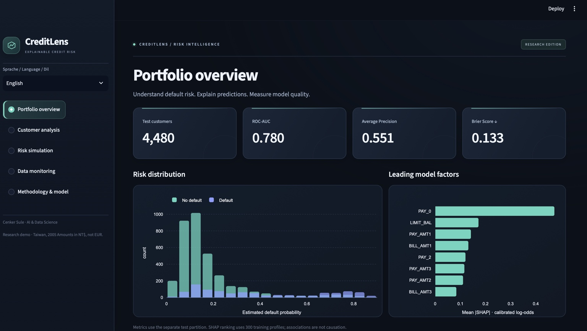

# CreditLens · Explainable Credit Risk

[Deutsch](README.md) | **English**

An interactive Python application for analysing next-month payment default risk among existing credit-card customers. CreditLens combines machine learning with individual explanations, an illustrative policy cost simulator and data monitoring.

**Author:** Cenker Sule · AI & Data Science

## Features

- Logistic Regression, XGBoost and constant-prevalence baseline comparison.
- Separate training, calibration, validation and test partitions.
- SHAP explanations that reconstruct the displayed calibrated prediction.
- Interactive threshold analysis with explicit review and missed-default costs.
- Batch CSV scoring, input validation and Population Stability Index monitoring.
- German, English and Turkish interface, with German selected by default.
- Reproducible model artifacts, automated tests and Docker configuration.

## Application preview



*Portfolio overview with the English interface. German and Turkish are also available in the language menu.*

## Measured results

Held-out test partition: **4,480 customers**, **21.56%** default prevalence. XGBoost configuration selection used validation Average Precision, not test performance.

| Model | ROC-AUC | Average Precision | Brier score ↓ |
| --- | ---: | ---: | ---: |
| Prevalence baseline | 0.500 | 0.216 | 0.1691 |
| Logistic Regression | 0.722 | 0.486 | 0.1441 |
| XGBoost, raw | 0.780 | 0.551 | 0.1331 |
| XGBoost, sigmoid-calibrated | 0.780 | 0.551 | 0.1332 |

Calibration **does not improve** test Brier score in this run. Both variants are reported; the calibrated variant is the predefined demonstration pipeline. Monotonic sigmoid calibration preserves ranking and therefore ROC-AUC and AP.

95% bootstrap intervals: ROC-AUC **0.763–0.797**, AP **0.516–0.585**. These quantify uncertainty in fixed test predictions, not the full training process. The validation-selected threshold is **0.22**, assuming 5 cost units per missed default and 1 per reviewed customer.

## Run with Docker

Install Docker Desktop and start its engine. Trained artifacts and source data are included. The initial image build requires internet access.

```bash
docker compose up --build
```

Open [http://localhost:8501](http://localhost:8501). Stop with `Ctrl+C`; remove the container using `docker compose down`.

## Run locally

Python 3.12 is recommended. On Apple Silicon, XGBoost may require `brew install libomp`.

```bash
python3.12 -m venv .venv
source .venv/bin/activate
python -m pip install -r requirements.txt
python -m pip install --no-deps -e .
python -m streamlit run app.py
```

## Reproduce training and run tests

```bash
python -m credit_risk.train
python -m pip install -r requirements-dev.txt
python -m pytest -q
```

Training verifies the UCI source file's SHA-256 hash and downloads it from UCI if absent. It regenerates `artifacts/report.json`, partition IDs, predictions, training reference profiles and models. Direct dependency versions are pinned; small numerical differences across platforms remain possible.

## Repository

| Path | Purpose |
| --- | --- |
| `app.py` | Trilingual Streamlit dashboard |
| `src/credit_risk/data.py` | Acquisition, validation and grouped splits |
| `src/credit_risk/train.py` | Training, calibration, selection and evaluation |
| `src/credit_risk/model.py` | Inference and additive SHAP explanations |
| `src/credit_risk/evaluation.py` | Metrics, policy costs and subgroup audit |
| `src/credit_risk/monitoring.py` | PSI and training-range monitoring |
| `artifacts/report.json` | Complete measured results |
| `docs/model_card.md` | Model assumptions and limitations |
| `docs/START_HERE_TR.md` | Turkish getting-started guide |

## Five-minute demonstration

1. Inspect model performance and risk distribution in the portfolio overview.
2. Select a sample customer and inspect their local SHAP contributions.
3. Change costs and thresholds in the illustrative policy simulator.
4. Compare the test portfolio with artificially shifted credit limits in data monitoring.
5. Upload `data/batch_example.csv` and download predictions. Its ten rows demonstrate functionality; they are insufficient for a reliable drift conclusion.

## Data and limitations

**Yeh, I. (2009), Default of Credit Card Clients, UCI Machine Learning Repository**, [DOI: 10.24432/C55S3H](https://doi.org/10.24432/C55S3H). 30,000 customers in Taiwan, April–September 2005 repayment history. Dataset license: [CC BY 4.0](https://creativecommons.org/licenses/by/4.0/). Amounts are in **NT$**, not EUR. Attribution and transformations: [data/README.md](data/README.md).

Sex, age, education, marital status and ID are excluded from model inputs. Sex and age are retained only for a descriptive subgroup audit. Exclusion does not establish fairness or eliminate proxy discrimination.

The dataset does not represent current German bank customers. There is no temporal or external validation. This portfolio research project estimates existing cardholders' next-month default risk and is not a production lending system. Reviews do not automatically prevent real losses; the policy simulator uses illustrative assumptions.

## Validation status

**26 automated tests passed**, covering split integrity, input validation, SHAP additivity, cost arithmetic, drift behaviour, prediction artifacts and all five views in three languages.

The application was started with Docker on a Mac and manually reviewed through Safari screenshots. The initial container package-path issue was fixed with an editable installation in the Dockerfile. The included GitHub Actions workflow also defines tests, a Docker build and a container healthcheck; its status is not known until it actually runs on GitHub.

The visual refresh does not change model artifacts, calculations or thresholds. For example, validation simulation with costs 14/4 and threshold 0.28 still yields a 25.6% review rate, 430 missed defaults and 2.344 cost units per customer.

Code: [MIT](LICENSE). Source and derived data: CC BY 4.0.
