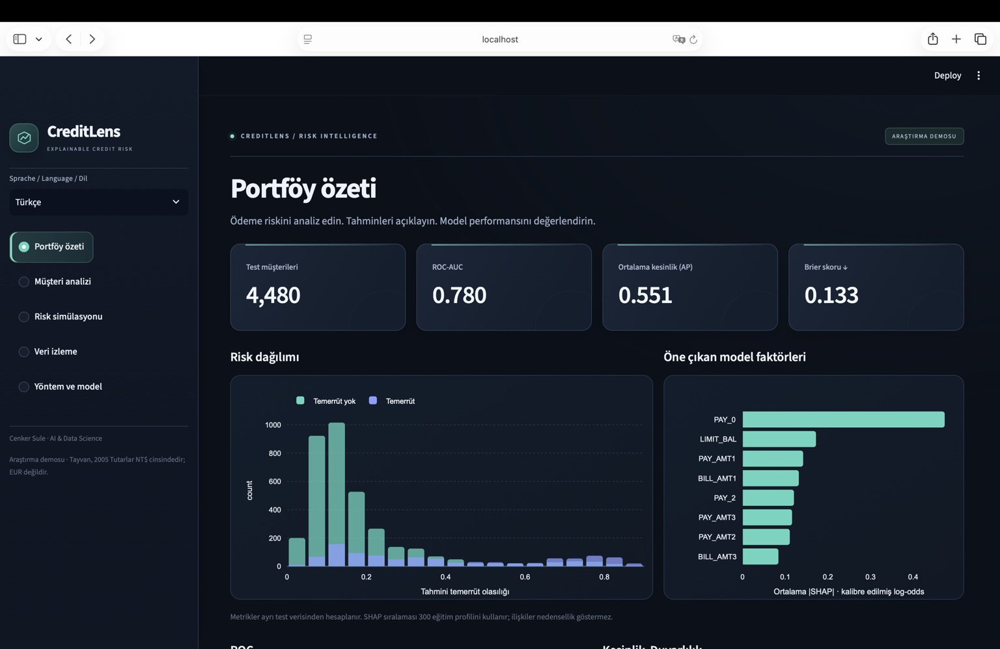
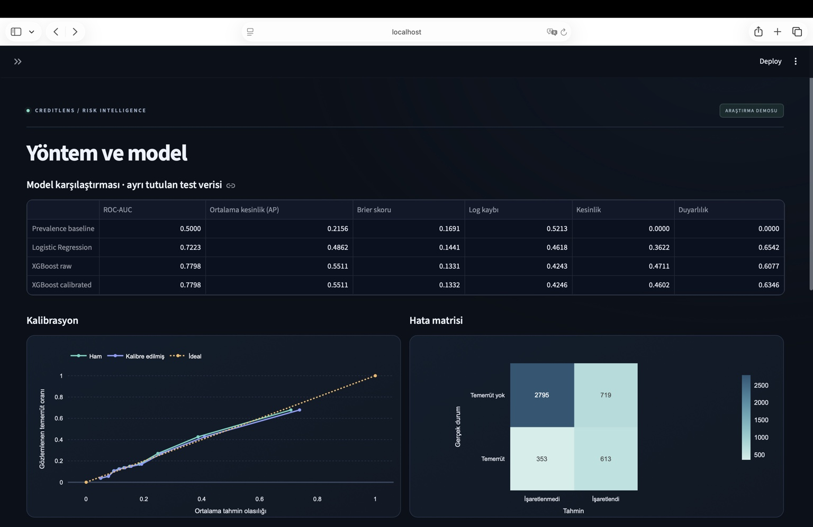

# CreditLens · Explainable Credit Risk

**Deutsch** | [English](README.en.md)

Eine interaktive Python-Anwendung zur Analyse des Zahlungsausfallrisikos bestehender Kreditkartenkunden. CreditLens verbindet Machine Learning mit nachvollziehbaren Einzelprognosen, einer illustrativen Kostensimulation und Datenmonitoring.

**Autor:** Cenker Sule · AI & Data Science

## Funktionsumfang

- Vergleich von Logistic Regression, XGBoost und einer konstanten Referenzprognose.
- Separate Partitionen für Training, Wahrscheinlichkeitskalibrierung, Validierung und Test.
- SHAP-Erklärungen, die die angezeigte kalibrierte Prognose rekonstruieren.
- Interaktive Schwellenwertsimulation mit expliziten Kostenannahmen.
- CSV-Stapelprognosen, Eingabeprüfung und Population Stability Index.
- Deutsche, englische und türkische Benutzeroberfläche; Deutsch ist die Voreinstellung.
- Reproduzierbare Modellartefakte, Tests und Docker-Konfiguration.

## Einblick in die Anwendung



*Aktuelle Anwendung in Safari auf macOS; hier mit türkischer Spracheinstellung. Deutsch ist die Standardsprache, Englisch und Türkisch sind im Menü verfügbar.*

<details>
<summary>Modellvergleich, Kalibrierung und Konfusionsmatrix anzeigen</summary>



</details>

## Gemessene Ergebnisse

Testpartition: **4.480 Kunden**, Ausfallquote **21,56 %**. Die XGBoost-Konfiguration wurde auf der Validierung gewählt, nicht auf dem Testdatensatz.

| Modell | ROC-AUC | Average Precision | Brier Score ↓ |
| --- | ---: | ---: | ---: |
| Konstante Referenz | 0,500 | 0,216 | 0,1691 |
| Logistic Regression | 0,722 | 0,486 | 0,1441 |
| XGBoost, unkalibriert | 0,780 | 0,551 | 0,1331 |
| XGBoost, sigmoid-kalibriert | 0,780 | 0,551 | 0,1332 |

Die Kalibrierung verbessert den Brier Score hier **nicht**. Beide Varianten bleiben sichtbar; die kalibrierte Variante dient als vorab definierte Demo-Pipeline. Eine monotone Sigmoid-Kalibrierung verändert die Rangfolge und damit ROC-AUC/AP nicht.

95-%-Bootstrap-Intervalle: ROC-AUC **0,763–0,797**, AP **0,516–0,585**. Diese Intervalle beschreiben die Unsicherheit der festen Testprognosen, nicht die gesamte Trainingsunsicherheit. Die gewählte Validierungsschwelle beträgt **0,22** bei Kosten von 5 Einheiten pro übersehenem Ausfall und 1 Einheit pro Prüfung.

## Start mit Docker

Voraussetzung: Docker Desktop mit laufender Docker Engine. Die trainierten Artefakte und die Quelldaten sind enthalten. Für den ersten Build ist Internet erforderlich.

```bash
docker compose up --build
```

Danach [http://localhost:8501](http://localhost:8501) öffnen. Beenden mit `Ctrl+C`, Container entfernen mit `docker compose down`.

## Lokal mit Python

Empfohlen: Python 3.12. Auf Apple Silicon benötigt XGBoost gegebenenfalls `brew install libomp`.

```bash
python3.12 -m venv .venv
source .venv/bin/activate
python -m pip install -r requirements.txt
python -m pip install --no-deps -e .
python -m streamlit run app.py
```

## Neu trainieren und testen

```bash
python -m credit_risk.train
python -m pip install -r requirements-dev.txt
python -m pytest -q
```

Das Training prüft den SHA-256-Hash der UCI-Quelldatei. Falls sie fehlt, wird sie von UCI geladen. Ein Lauf erzeugt `artifacts/report.json`, feste Partitions-IDs, Prognosen, Referenzverteilungen und Modellartefakte neu. Abhängigkeiten sind direkt versioniert; Ergebnisse können zwischen Plattformen geringfügig variieren.

## Aufbau

| Pfad | Inhalt |
| --- | --- |
| `app.py` | Dreisprachiges Streamlit-Dashboard |
| `src/credit_risk/data.py` | Datenquelle, Eingabeprüfung, gruppierte Aufteilung |
| `src/credit_risk/train.py` | Training, Kalibrierung, Auswahl und Auswertung |
| `src/credit_risk/model.py` | Inferenz und additive SHAP-Erklärungen |
| `src/credit_risk/evaluation.py` | Kennzahlen, Kostenmodell, Subgruppen |
| `src/credit_risk/monitoring.py` | PSI und Wertebereichskontrolle |
| `artifacts/report.json` | Vollständige gemessene Ergebnisse |
| `docs/model_card.md` | Modellannahmen und Einschränkungen |
| `docs/START_HERE_TR.md` | Kurzanleitung auf Türkisch |

## Kurze Demo

1. In der Portfolioübersicht Modellgüte und Risikoverteilung ansehen.
2. In der Einzelfallanalyse ein Beispiel wählen und die lokalen SHAP-Beiträge prüfen.
3. In der Simulation Kosten und Schwelle verändern; dies sind illustrative Annahmen.
4. Im Datenmonitoring die künstlich verschobenen Kreditlimits mit dem Testportfolio vergleichen.
5. `data/batch_example.csv` hochladen und die erzeugten Prognosen herunterladen. Die zehn Zeilen dienen dem Funktionstest; daraus lässt sich kein belastbarer PSI-Befund ableiten.

## Daten und Grenzen

Quelle: **Yeh, I. (2009), Default of Credit Card Clients, UCI Machine Learning Repository**, [DOI: 10.24432/C55S3H](https://doi.org/10.24432/C55S3H). 30.000 Kunden aus Taiwan, Zahlungshistorie April–September 2005. Lizenz: [CC BY 4.0](https://creativecommons.org/licenses/by/4.0/). Beträge sind in **NT$**, nicht EUR. Attribution und Anpassungen stehen in [data/README.md](data/README.md).

Geschlecht, Alter, Bildung, Familienstand und Kunden-ID sind keine Modellmerkmale. Geschlecht und Alter werden nur für eine beschreibende Subgruppenprüfung verwendet. Der Ausschluss solcher Merkmale beweist keine Fairness.

Die Daten zeigen keine aktuelle deutsche Bankpopulation. Es gibt keine zeitliche oder externe Validierung. Die Anwendung ist ein Portfolio- und Forschungsprojekt für bestehende Kreditkartenkunden, keine produktionsreife Kreditentscheidung. Eine Prüfung verhindert reale Ausfallverluste nicht automatisch; die Kostensimulation ist ausdrücklich illustrativ.

## Technische Validierung

**26 automatisierte Tests bestanden.** Geprüft werden Partitionsintegrität, Eingabevalidierung, SHAP-Additivität, Kostenrechnung, Driftverhalten, gespeicherte Prognosen und alle fünf Ansichten in drei Sprachen.

Die Anwendung wurde auf einem Mac mit Docker gestartet und in Safari anhand von Screenshots manuell geprüft. Das ursprüngliche Problem bei der Paketsuche im Container wurde durch die editierbare Installation im Dockerfile behoben. Der enthaltene GitHub-Actions-Workflow definiert zusätzlich Tests sowie Docker-Build und Healthcheck; sein Status ist erst nach einem tatsächlichen Lauf auf GitHub bekannt.

Die rein visuelle Überarbeitung verändert keine Modellartefakte, Berechnungen oder Schwellenwerte. Beispielsweise liefert die Validierungssimulation bei Kosten 14/4 und Schwelle 0,28 weiterhin 25,6 % Prüfquote, 430 übersehene Ausfälle und 2,344 Kosteneinheiten pro Kunde.

Code: [MIT](LICENSE). Quelldaten und abgeleitete Datendateien: CC BY 4.0.
